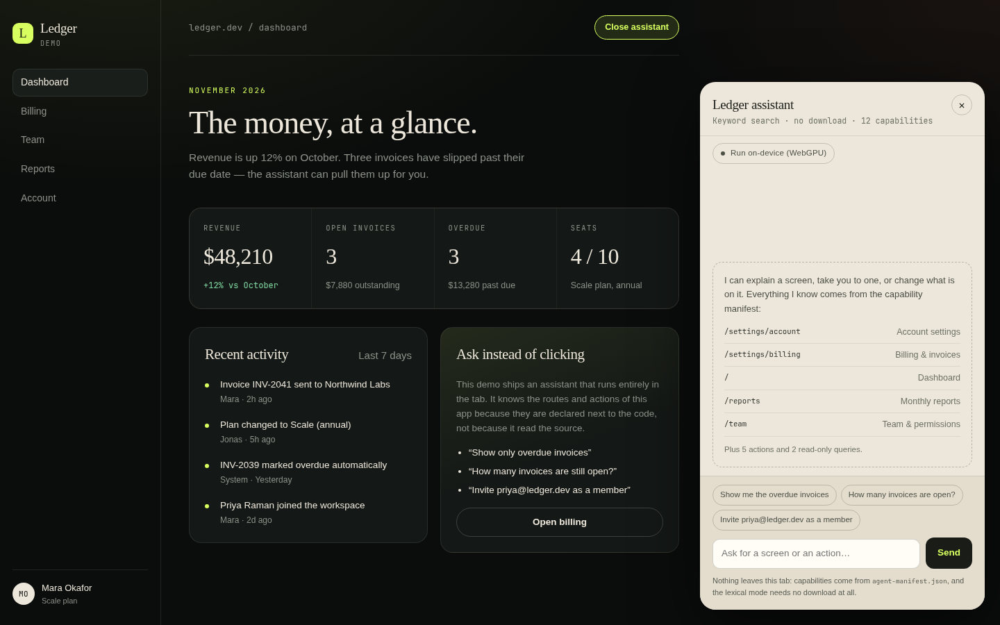
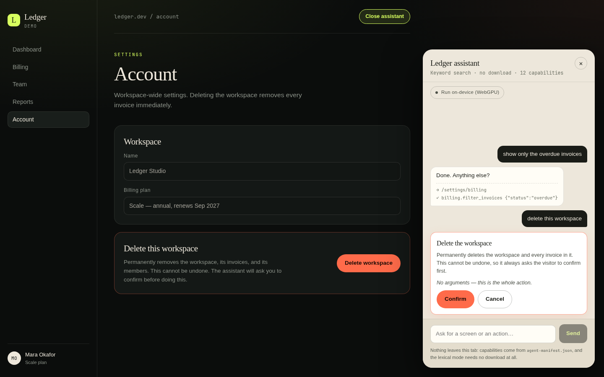

# client-agent

**Ground a browser assistant in your app's real routes and actions, run the model in the tab, and let it click for the user — without a server or an inference bill.**


Most "AI in your app" implementations stream the DOM to a server, pay per token, and hand a language model a bag of selectors. This package takes the opposite position:

- **The app publishes a contract, not a DOM dump.** Co-located `defineCapability()` declarations are extracted at build time into a small JSON manifest. The assistant knows exactly which screens and operations exist because the build said so.
- **The model runs in the tab.** WebLLM on WebGPU inside a worker, cached after the first load. No API key, no per-token cost, no prompts leaving the device.
- **Every call is checked before it runs.** Ids must exist in the manifest, arguments must satisfy the JSON Schema, mutating actions pass a confirmation gate, and a turn is capped at three sequential calls.

```bash
npm install client-agent          # once the npm release runs; until then use the tarball below
npx client-agent init --skill     # writes the skill that keeps capabilities in sync
```

Until the npm token is in place, every version is also attached to its GitHub release, which npm
installs directly and which ships a prebuilt `dist/`:

```bash
npm install https://github.com/shobyde/client-agent/releases/download/v0.1.5/client-agent-0.1.5.tgz
```

## The pieces

| Subpath | What it is |
| --- | --- |
| `client-agent/core` | Registry, JSON Schema validator, BM25 retrieval, prompt assembly, tool-call parser, the execution loop, and a deterministic fallback engine |
| `client-agent/vite` | AST scanner for `defineCapability()` that emits `agent-manifest.json` and serves it as a virtual module |
| `client-agent/react` | `<AgentProvider>`, `useAgentChat()`, `useRegisterCapability()` |
| `client-agent/webllm` | WebGPU worker bridge with download progress and cache reuse |
| `client-agent/dom` | `createDomContextReader()`: labelled, budgeted page text for grounding a model in real content |
| `client-agent/cli` | `verify`, `manifest`, `codes`, `init --skill`, and a self-check corpus runner |

One package, five entry points. `react`, `vite` and `@mlc-ai/web-llm` are optional peers, so install the ones your app uses. `typescript` is a regular dependency because the manifest crawler and the Vite plugin parse with its AST.

## Declaring a capability

Capabilities live next to the feature that owns the behaviour, not in a central file that rots.

```ts
import { defineCapability } from 'client-agent/core';

export const filterInvoices = defineCapability({
  id: 'billing.filter_invoices',
  kind: 'action',
  title: 'Filter invoices by status',
  description:
    'Filters the invoice table down to paid, open, or overdue invoices, so the visitor can see just the ones that still need paying.',
  keywords: ['filter', 'show only', 'unpaid', 'overdue'],
  route: '/settings/billing',
  paramsSchema: {
    type: 'object',
    properties: { status: { type: 'string', enum: ['paid', 'open', 'overdue'] } },
    required: ['status'],
    additionalProperties: false,
  },
  handler: async ({ status }, ctx) => {
    if (ctx.currentRoute !== '/settings/billing') await ctx.navigate('/settings/billing');
    ctx.dispatch('invoices:filter', { status });
    return { appliedFilter: status };
  },
});
```

`kind: 'route'` is a destination the assistant can explain and navigate to. `kind: 'action'` is a state change with a handler. `kind: 'query'` is read-only state the model may inspect before deciding (open invoice count, active filters).

## Wiring it up

```ts
// vite.config.ts
import { defineConfig } from 'vite';
import react from '@vitejs/plugin-react';
import { clientAgent } from 'client-agent/vite';

export default defineConfig({
  worker: { format: 'es' }, // WebLLM splits its own chunks
  plugins: [react(), clientAgent({ include: ['src/**/*.{ts,tsx}'] })],
});
```

```tsx
// app.tsx
import manifest from 'client-agent:manifest';
import { AgentProvider } from 'client-agent/react';
import { createLexicalEngine } from 'client-agent/core';

<AgentProvider
  engine={createLexicalEngine({ capabilities: manifest.capabilities })}
  capabilities={manifest.capabilities}
  getSnapshot={() => ({ currentRoute: location.pathname, state: { openInvoices: 3 } })}
  navigate={(route) => router.navigate(route)}
  dispatch={(event, payload) => store.handle(event, payload)}
>
  <App />
</AgentProvider>
```

Handlers register on mount, so an action declared for another screen is not callable until that screen exists. The runtime handles that: it navigates to `capability.route`, waits up to 2s for the handler, then runs it. `useRegisterCapability(capability)` inside a page component is the whole integration.

## Grounding the model in the page

Capability metadata says what the app can do. It does not say what the page says. Pass
`readContext` and the runtime carries that text into the prompt on every turn, under its own budget:

```js
import { createDomContextReader } from 'client-agent/dom';

const readContext = createDomContextReader({
  sections: [
    { selector: '#about', label: 'About' },
    { selector: '#projects', label: 'Projects' },
    { selector: '#experience', label: 'Experience' },
  ],
  maxChars: 2600,
});

new AgentRuntime({ engine, capabilities, registry, getSnapshot, readContext /* ... */ });
```

Sections are ranked by the visitor's words, so a question about experience keeps that text and drops the
blog when the budget is tight. In the prompt the model is told to answer from that content and to offer
to take the visitor to the section when seeing it would help.

## Answers that are UI

A handler can return a declarative surface instead of a sentence. The loop does not interpret it: it
emits a `surface` step and the host renders it with its own components.

```ts
handler: async ({ project }) => ({ surface: projectCard(project) })
```

A2UI 1.0 streams (`createSurface` / `updateComponents` / `updateDataModel`) are one shape that fits; a
host can use its own. shobyde.com renders A2UI components with native elements, so the agent names
components and the page keeps its design system, and `groundglass` checks every surface the assistant
can emit in CI.

## No React? The core is framework-free

`client-agent/react` is a convenience, not the contract. shobyde.com runs the same package in a
Vite page with no framework at all: it imports the generated manifest, registers the handlers, and
renders its own panel.

```js
import manifest from 'client-agent:manifest';
import { AgentRuntime, createLexicalEngine, registry } from 'client-agent/core';
import { siteCapabilities } from './capabilities.js';

for (const capability of siteCapabilities) registry.register(capability);

const runtime = new AgentRuntime({
  engine: createLexicalEngine({ capabilities: manifest.capabilities }),
  capabilities: manifest.capabilities,   // what the model may choose from
  registry,                              // what can actually run
  getSnapshot: () => ({ currentRoute: location.hash || '#hero' }),
  navigate: (route) => document.querySelector(route)?.scrollIntoView(),
  dispatch: (event, payload) => handle(event, payload),
});

const { text, steps } = await runtime.send('open the printable resume');
```

Hash routes are supported for anchor navigation (`route: '#projects'`), and a `query` capability
can return `{ answer }` to phrase its own reply when the keyword engine is doing the talking.

## What `verify` actually prints

Real output, from the demo app in `apps/demo`:

```console
$ client-agent verify apps/demo
12 capabilities · 5 routes · 17 files scanned
clean
```

And on a fixture where an action sounds destructive but has no confirmation gate:

```console
$ client-agent verify fixtures/selfcheck/unsafe-action
src/capabilities.ts:3  warning  CAP007  action sounds like it mutates state; set requiresConfirmation: true unless it is reversible and cheap

1 capability · 0 routes · 1 file scanned
1 warning
```

Every code is stable and documented, so CI output is citable:

| Code | Severity | Meaning |
| --- | --- | --- |
| `CAP001` | error | Duplicate capability id |
| `CAP002` | error | Title/description missing or too short to retrieve on |
| `CAP003` | error | Route capability without a usable `/` path |
| `CAP004` | error | Malformed `paramsSchema` structure |
| `CAP005` | warning | Schema keyword the runtime cannot enforce (`$ref`, `format`) |
| `CAP006` | error | Declaration is not statically evaluable, so no manifest entry |
| `CAP007` | warning | Mutating action without `requiresConfirmation` (id or title names the mutation, and the title does not open with a read-only verb) |
| `CAP008` | warning | Router path with no route capability (heuristic) |
| `CAP009` | error | Invalid id or kind |
| `CAP010` | warning | Two capabilities claim the same route |

`npx client-agent codes` prints the table; `client-agent verify --strict` fails on warnings too.

## The safety model

Allowing a language model to call functions in a live app is the risky part, so the boundaries are structural rather than prompted:

1. **Allowlisted registry.** No `eval`, no selector clicking, no generated code. The loop matches a parsed id against the manifest and calls the handler registered for it, or nothing.
2. **Schema validation with one retry.** Arguments are validated against `paramsSchema`. A failure is replayed to the model verbatim (`arguments.status must be one of "paid", "open", "overdue" (enum)`) with one chance to correct, then surfaced as a polite message. Small local models recover from this far more often than from a generic "invalid request".
3. **Confirmation gate.** `requiresConfirmation: true` pauses the turn, emits the request to the UI, and only calls the handler on an explicit approve. Cancel ends the turn with "Cancelled. Nothing was changed." Confirmation is for side effects, not for filtering the table.
4. **Step cap.** At most 3 sequential tool calls per message (`maxToolCalls`), so a confused 1B model cannot loop.

The model never sees a URL it can invent, a selector it can guess, or a function it can name. It selects from a list the build produced.

## Engines: WebGPU, then keywords, then yours

- **`createWebLLMEngine()`** — WebGPU worker, ~1.2 GB compact tier / ~2.4 GB standard, progress events, cached by the engine after first load. Nothing downloads until the chat is opened.
- **`createLexicalEngine()`** — deterministic BM25 over the manifest. It navigates, calls actions when every required argument is unambiguous from the visitor's words (enum value present, email present), and asks otherwise. No download, no GPU, testable in CI. This is what the screenshots above run on.
- **`AgentEngine`** — a six-line interface (`id` + `complete(messages, tools)`). Wrap your own endpoint, a hosted model, or a test double.

Retrieval keeps the prompt under ~1,500 tokens: top-8 capabilities by BM25 over title/keywords/description, boosted for the current route, with one line per capability.

## The demo

```bash
pnpm install
pnpm build
pnpm --filter demo dev        # http://localhost:5173
```

It is a small invoices app ("Ledger") with five routes and twelve capabilities. Nothing about the assistant is hard-coded to those pages: the manifest is generated from the declarations beside the pages, and the same handlers back the buttons.





## What is verified, and what is not

Verified on this machine:

- `pnpm test` — 57 tests across schema validation, BM25 ranking, prompt budgeting, output parsing, the tool loop (navigation, late handler registration, schema retry, confirmation approve/cancel, step cap), the AST extractor, and the lexical engine.
- `client-agent verify --self-check fixtures/selfcheck` — 9/9 fixtures produce exactly the diagnostic codes they declare, including the clean fixture producing none.
- The demo in headless Chromium: "show only the overdue invoices" navigates from `/` to `/settings/billing` and filters the table to three overdue rows; "delete this workspace" raises the confirmation card; Cancel leaves state untouched; Confirm fires the action and shows the deletion banner.

Not verified here:

- **WebGPU inference on real hardware.** This machine has no WebGPU-capable browser, so the worker path is typed, built, and wired (the demo emits its worker chunk) but no token has been generated through it here. Treat model quality and latency as unmeasured.
- Browser support beyond Chromium for the demo, and Safari/Firefox WebGPU behaviour.
- Token counts are `chars / 4` estimates; the budget is approximate by design.
- `CAP008` route detection is a heuristic over React Router JSX and `path:` literals. File-based routers (Next `app/`, Remix) are not scanned yet.

## Repo layout

```
packages/client-agent/src/
  core/    types, define, registry, schema, retriever, prompt, tools, loop, lexical engine
  build/   AST extractor, glob matcher, diagnostic codes, terminal report
  vite/    plugin: scan, emit manifest, virtual module, dev watcher
  cli/     verify / manifest / codes / init / self-check + the shipped skill
  react/   provider, useAgentChat, useRegisterCapability
  webllm/  worker, engine bridge, auto engine
apps/demo/          the Ledger app used in the screenshots
fixtures/selfcheck/ nine fixtures, each declaring the codes it must provoke
docs/media/         stills captured from the running demo
```

## Status

`0.1.5`. The core loop, extractor, CLI, and React bindings are deliberately small and covered by tests; the WebLLM adapter is the piece with the least runtime evidence, as noted above. Publishing is wired in `.github/workflows/release.yml` and runs on a tag once an `NPM_TOKEN` secret exists; until then the release tarball is the install path. It is already running in production on shobyde.com.

MIT.
