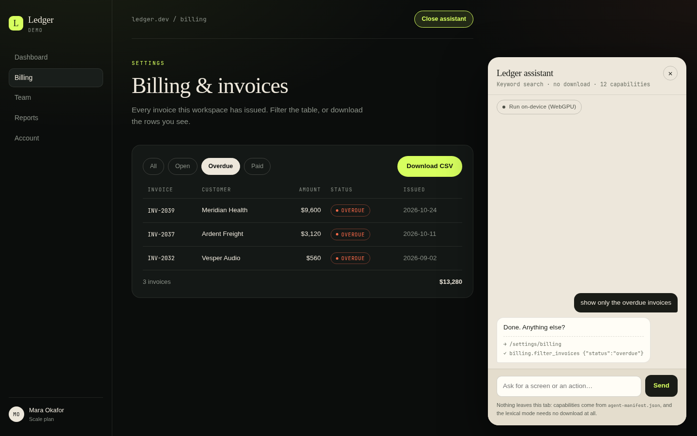

# boaz

**Ground a browser assistant in your app's real routes, actions and data — with no model to download, no API key, and every sentence traceable to a fact.**

**Why the name.** In Ruth 4, Boaz settles a transaction at the city gate, in front of the elders, where the record is kept: "you are witnesses this day." In Ruth 2:11 he answers a question from what he had been told, not from what he could guess. That is the contract this package keeps, so the name is a reminder rather than a metaphor: answers come from the record, and changes happen where they can be seen.



Most "AI in your app" implementations stream the DOM to a server, pay per token, and hand a language model a bag of selectors. This package takes the opposite position:

- **The app publishes a contract, not a DOM dump.** Co-located `defineCapability()` declarations are extracted at build time into a small JSON manifest. The assistant knows exactly which screens and operations exist because the build said so.
- **The app declares facts, the library evaluates the rules.** `KnowledgeBase` holds rows plus Datalog-style rules; `createRulesEngine()` joins them against the question, then composes a sentence from the result. No weights, no GPU, no network.
- **Every call is checked before it runs.** Ids must exist in the manifest, arguments must satisfy the JSON Schema, mutating actions pass a confirmation gate, and a turn is capped at three sequential calls.
- **Replies can stream, with provenance.** `streaming: { chunkChars, paceMs }` emits `delta` events on the same channel as tool steps, and a rule answer carries the goal, the terms it matched and the rule it applied.

```bash
npm install @shobyde/boaz
npx boaz init --skill     # writes the skill that keeps capabilities in sync
npx boaz audit --probes agent-probes.json --module agent-setup.mjs
npx boaz bench --probes agent-probes.json --module agent-setup.mjs --samples
```

Every version is also attached to its GitHub release, which npm installs directly and which ships a
prebuilt `dist/`:

```bash
npm install https://github.com/shobyde/boaz/releases/download/v0.9.4/boaz-0.9.4.tgz
```

## The pieces

| Subpath | What it is |
| --- | --- |
| `@shobyde/boaz/core` | Registry, JSON Schema validator, BM25 retrieval, prompt assembly, tool-call parser, the execution loop, and a deterministic keyword engine |
| `@shobyde/boaz/rules` | `KnowledgeBase` (facts + Datalog rules), `createRulesEngine()`, and the answer-rule contract that turns solutions into replies |
| `@shobyde/boaz/vite` | AST scanner for `defineCapability()` / `defineKnowledge()` that emits `agent-manifest.json` and serves it as a virtual module |
| `@shobyde/boaz/react` | `<AgentProvider>`, `useAgentChat()`, `useRegisterCapability()` |
| `@shobyde/boaz/dom` | `createDomContextReader()`: labelled, budgeted page text, for a custom engine that wants grounding |
| `@shobyde/boaz/cli` | `verify`, `manifest`, `codes`, `audit`, `bench`, `init --skill`, and a self-check corpus runner |

One package, six entry points. `react` and `vite` are optional peers, so install the ones your app uses. `typescript` is a regular dependency because the manifest crawler and the Vite plugin parse with its AST.

## Declaring a capability

Capabilities live next to the feature that owns the behaviour, not in a central file that rots.

```ts
import { defineCapability } from '@shobyde/boaz/core';

export const filterInvoices = defineCapability({
  id: 'billing.filter_invoices',
  kind: 'action',
  title: 'Filter invoices by status',
  description:
    'Filters the invoice table down to paid, open, or overdue invoices, so the visitor can see just the ones that still need paying.',
  keywords: ['filter', 'show only', 'unpaid', 'overdue'],
  route: '/settings/billing',
  paramsSchema: {
    type: 'object',
    properties: { status: { type: 'string', enum: ['paid', 'open', 'overdue'] } },
    required: ['status'],
    additionalProperties: false,
  },
  handler: async ({ status }, ctx) => {
    if (ctx.currentRoute !== '/settings/billing') await ctx.navigate('/settings/billing');
    ctx.dispatch('invoices:filter', { status });
    return { appliedFilter: status };
  },
});
```

`kind: 'route'` is a destination the assistant can explain and navigate to. `kind: 'action'` is a state change with a handler. `kind: 'query'` is read-only state, and can return `{ answer }` to phrase its own reply. `kind: 'knowledge'` (see `defineKnowledge()`) is prose the assistant may quote verbatim.

## Facts and rules

Prose answers "what is this page about". Rows and rules answer "which ones".

```ts
import { KnowledgeBase, createRulesEngine, fact } from '@shobyde/boaz/rules';

const knowledge = new KnowledgeBase({
  facts: [
    ...invoices.map((invoice) =>
      fact('invoice', invoice.id, invoice.customer, invoice.status, String(invoice.amount))),
  ],
  // The library injects `asked(<term>)` for every declared constant the visitor
  // names, so a rule can talk about the question without seeing raw text.
  rules: ['invoices_with(?I, ?C, ?S, ?A) :- invoice(?I, ?C, ?S, ?A), asked(?S).'],
});

const engine = createRulesEngine({
  knowledge,
  answers: [
    {
      id: 'invoices.by_status',
      title: 'Which invoices have a status',
      keywords: ['overdue invoices', 'unpaid', 'paid invoices', 'open invoices'],
      goal: 'invoices_with(?I, ?C, ?S, ?A)',
      compose: ({ solutions }) => {
        if (solutions.length === 0) return '';
        const rows = solutions.map(
          (s) => `${s.bindings['?I']} (${s.bindings['?C']}, $${Number(s.bindings['?A']).toLocaleString('en-US')})`,
        );
        return `${solutions.length} invoice${solutions.length === 1 ? '' : 's'}: ${rows.join(', ')}.`;
      },
    },
  ],
});
```

The engine picks an answer rule with BM25 over its title and keywords, runs the goal against the
knowledge base (with the question's terms as assumptions), and calls `compose` with the solutions.
When no rule matches, or `compose` returns an empty string, it hands the turn to the keyword engine,
which navigates and calls actions from the manifest.

Answers come back with the trace attached:

```ts
const { text, steps } = await runtime.send('which invoices are overdue?');
// text: "3 invoices: INV-2039 (Meridian Health, $9,600), INV-2037 (Ardent Freight, $3,120), INV-2032 (Vesper Audio, $560)."
// steps: [{ type: 'inference', // a rule step
//           goal: 'invoices_with(?I, ?C, ?S, ?A)', terms: ['overdue'],
//           solutions: [...], rule: 'invoices_with(?I, ?C, ?S, ?A) :- invoice(?I, ?C, ?S, ?A), asked(?S)' }]
```

That step is what makes the reply auditable: the sentence came from those rows, and you can show
which ones. A model cannot make that claim.

## Wiring it up

```ts
// vite.config.ts
import { defineConfig } from 'vite';
import react from '@vitejs/plugin-react';
import { boaz } from '@shobyde/boaz/vite';

export default defineConfig({
  plugins: [react(), boaz({ include: ['src/**/*.{ts,tsx}'] })],
});
```

```tsx
// app.tsx
import manifest from 'boaz:manifest';
import { AgentProvider } from '@shobyde/boaz/react';
import { createRulesEngine } from '@shobyde/boaz/rules';

<AgentProvider
  engine={createRulesEngine({ knowledge, answers, capabilities: manifest.capabilities })}
  capabilities={manifest.capabilities}
  getSnapshot={() => ({ currentRoute: location.pathname, state: { openInvoices: 3 } })}
  navigate={(route) => router.navigate(route)}
  dispatch={(event, payload) => store.handle(event, payload)}
  streaming={{ chunkChars: 16, paceMs: 18 }}
>
  <App />
</AgentProvider>
```

Handlers register on mount, so an action declared for another screen is not callable until that screen exists. The runtime handles that: it navigates to `capability.route`, waits up to 2s for the handler, then runs it. `useRegisterCapability(capability)` inside a page component is the whole integration.

## Streaming

`streaming` reveals the reply as `delta` events instead of one block. The text is already known when
the first delta fires, so this is pacing, not computation: a host that wants instant text leaves it off,
and a host that shows a transcript gets the same event shape it uses for tool steps.

```
step    rule        overdue(?I, ?C, ?A)   terms: [overdue]   0ms
delta   "3 overdue: "
delta   "INV-2039 (Meridian Health), "
...
turn    text = "3 overdue: INV-2039 (...)."
```

For a deterministic engine the honest thing to stream is the trace, not a fake progress bar:
the trace is real and it arrives in about a millisecond.

## Grounding (only when you bring your own engine)

Capability metadata says what the app can do. It does not say what the page says. If you plug in a
hosted model, pass `readContext` and the runtime carries page text into the prompt under its own budget:

```js
import { createDomContextReader } from '@shobyde/boaz/dom';

const readContext = createDomContextReader({
  sections: [
    { selector: '#about', label: 'About' },
    { selector: '#projects', label: 'Projects' },
    { selector: '#experience', label: 'Experience' },
  ],
  maxChars: 2600,
});

new AgentRuntime({ engine, capabilities, registry, getSnapshot, readContext /* ... */ });
```

Sections are ranked by the visitor's words, so a question about experience keeps that text and drops the
blog when the budget is tight. The default engines ignore `readContext` entirely.

## Answers that are UI

A handler can return a declarative surface instead of a sentence. The loop does not interpret it: it
emits a `surface` step and the host renders it with its own components.

```ts
handler: async ({ project }) => ({ surface: projectCard(project) })
```

A2UI 1.0 streams (`createSurface` / `updateComponents` / `updateDataModel`) are one shape that fits; a
host can use its own. shobyde.com renders A2UI components with native elements, so the agent names
components and the page keeps its design system, and `groundglass` checks every surface the assistant
can emit in CI.

## The conversation facade

`createConversation` is the SDK-shaped entry point. Give it a system prompt, the
domain knowledge, and tools. It owns the runtime, working memory, turn
classification and tool continuation; the app owns the facts, the handlers and
the rendering.

```js
import { createConversation } from '@shobyde/boaz/conversation';
import { defineCapability } from '@shobyde/boaz/core';

const chat = createConversation({
  system: 'Answer from the project record. Never invent a repository.',
  knowledge: { facts, rules, answers },
  subjects: ['Boaz', 'Hobnob', 'Readback'],
  tools: [
    defineCapability({
      id: 'github.activity',
      kind: 'query',
      title: 'Read GitHub activity',
      description: 'Reads commit and release counts for a repository.',
      paramsSchema: {
        type: 'object',
        properties: { repo: { type: 'string', enum: ['boaz', 'hobnob', 'readback'] } },
        required: ['repo'],
        additionalProperties: false,
      },
      handler: async ({ repo }) => ({ answer: `${repo}: 81 commits.` }),
      // Optional: the host knows the repository names. The facade still runs
      // the capability through the same schema and handler path.
      resolve: (question) => (/hobnob/i.test(question) ? { repo: 'hobnob' } : null),
    }),
  ],
  getSnapshot: () => ({ currentRoute: location.pathname }),
});

const turn = await chat.ask('how many commits does Hobnob have?');
const next = await chat.ask('what about Readback?');

next.text;        // the answer
next.steps;       // the same trace steps the runtime emits
next.surfaces;    // any surface steps the tools returned
next.kind;        // fresh, continue-new-subject, command, recap...
chat.memory;      // the working set and the last-tool record
chat.reset();     // clear runtime and memory together
```

`system` is instructions for the host or a model prompt; it is not a fact.
`knowledge` is the fact/rule base. `tools` are the capabilities, schemas and
handlers. The facade never touches the DOM and never makes a network call on
its own.

### Streaming, not just a final string

`ask()` is the convenience that collects the turn. `stream()` (also `query()`)
exposes the same turn as typed events, which is the shape a UI or another agent consumes:

```js
for await (const event of chat.stream('how many commits does Hobnob have?')) {
  switch (event.type) {
    case 'turn.started':
      // event.kind, event.classification
      break;
    case 'text.delta':
      process.stdout.write(event.text);
      break;
    case 'tool.use':
      // event.id, event.args
      break;
    case 'tool.result':
      // event.ok, event.text, event.result, event.steps
      break;
    case 'surface':
      // event.messages, a declarative surface to render
      break;
    case 'turn.completed':
      // event.turn.text, steps, surfaces, memory record
      break;
  }
}
```

The event union is:

```ts
turn.started | retrieval | text.delta | step | tool.use |
tool.result | surface | turn.completed | error
```

There is no token stream because there is no model. A text delta is the finished
sentence delivered in display chunks; `streaming: false` makes it one chunk.
Tool calls, results, trace steps and surfaces stay separate objects instead of
being flattened into the sentence.

`onEvent` receives the same events when a consumer prefers a callback over an
async iterator. `ask()` simply drains `stream()` and returns `turn.completed`.

Tools may carry a `resolve(query, context)` hook for domain dispatch that
retrieval cannot infer, such as a repository name or a chart subject. The hook
returns arguments only. Validation, execution and follow-up memory stay in the
facade.

A tool can also omit `resolve` and let the normal matcher choose it. The two
paths share the same capability id, schema and handler.

## Follow-ups that keep the last tool

A conversation can repeat an operation on a new subject:

```text
how many commits does Boaz have?
what about Hobnob?
```

`createWorkingMemory` records the capability, its arguments and the effective
question for a turn. `memory.followUpTool()` turns the second sentence into the
first with the subject replaced, so the app's normal matcher and schema still
choose the capability and validate the arguments:

```js
import { createWorkingMemory } from '@shobyde/boaz/core';

const memory = createWorkingMemory({ subjects: ['Boaz', 'Hobnob'] });

memory.observe('how many commits does Boaz have?', {
  capabilityId: 'github.activity',
  args: { repo: 'boaz' },
  entities: ['Boaz'],
});

const next = memory.followUpTool('what about Hobnob?');
// {
//   capabilityId: 'github.activity',
//   query: 'how many commits does Hobnob have?',
//   previousSubject: 'Boaz',
//   subject: 'Hobnob',
//   previousQuery: 'how many commits does Boaz have?',
//   previousArgs: { repo: 'boaz' }
// }
```

The primitive only rewrites. The host passes `next.query` back through its own
resolver; the old args are kept for a host that maps arguments directly rather
than re-matching. It does not fire when there is no recent tool turn, when the
follow-up names no new subject, or when the old subject is not in the previous
question.

## No React? The core is framework-free

`@shobyde/boaz/react` is a convenience, not the contract. shobyde.com runs the same package in a
Vite page with no framework at all: it imports the generated manifest, registers the handlers, and
renders its own panel.

```js
import manifest from 'boaz:manifest';
import { AgentRuntime, registry } from '@shobyde/boaz/core';
import { createRulesEngine } from '@shobyde/boaz/rules';
import { siteCapabilities } from './capabilities.js';

for (const capability of siteCapabilities) registry.register(capability);

const runtime = new AgentRuntime({
  engine: createRulesEngine({ knowledge, answers, capabilities: manifest.capabilities }),
  capabilities: manifest.capabilities,   // what the assistant may choose from
  registry,                              // what can actually run
  getSnapshot: () => ({ currentRoute: location.hash || '#hero' }),
  navigate: (route) => document.querySelector(route)?.scrollIntoView(),
  dispatch: (event, payload) => handle(event, payload),
});

const { text, steps } = await runtime.send('open the printable resume');
```

Hash routes are supported for anchor navigation (`route: '#projects'`).

## Proving the assistant answers (audit and bench)

`verify` checks the declarations. These two check the conversation, against the
engine your app actually runs:

```bash
npx boaz audit --probes agent-probes.json --module agent-setup.mjs
npx boaz bench --probes agent-probes.json --module agent-setup.mjs --samples
```

`agent-probes.json` is one question per line, with what a correct answer looks
like:

```json
{
  "questions": [
    { "question": "which invoices are overdue?", "expect": "invoices.overdue",
      "intent": "invoices.overdue", "must": ["Northwind", "Fabrikam"] },
    { "question": "filter to overdue", "expect": "invoices.filter", "args": { "status": "overdue" } }
  ]
}
```

`audit` reports the engine's own decision — the rule that planned a tool call, the
capability that ran, or the knowledge paragraph that was quoted — and exits 1 on
any miss. `bench` groups the probes by `intent` and scores the copy: fidelity
(required facts present), paraphrase similarity with the facts masked, opener
variety, length spread, and stability. Only intents with a `must` list are scored.

`agent-setup.mjs` is the bridge: it exports `createEngine()` (and optionally
`runCapability`, `answers`, `capabilities`) so the harness asks your app instead
of reimplementing it. The skill written by `init --skill` documents the whole
loop.

No probe file yet? Generate one from the manifest:

```bash
npx boaz probes --generate --manifest dist/agent-manifest.json
```

Every capability title and keyword becomes a question that expects the
capability it came from. It reports the two things it cannot decide for you:
phrases that two capabilities in the same query class both claim, and
capabilities that need arguments (a phrase names what to open, not which one).
Edit the wording, then run `audit`.

## What `verify` actually prints

Real output, from the demo app in `apps/demo`:

```console
$ boaz verify apps/demo
12 capabilities · 5 routes · 17 files scanned
clean
```

And on a fixture where an action sounds destructive but has no confirmation gate:

```console
$ boaz verify fixtures/selfcheck/unsafe-action
src/capabilities.ts:3  warning  CAP007  action sounds like it mutates state; set requiresConfirmation: true unless it is reversible and cheap

1 capability · 0 routes · 1 file scanned
1 warning
```

Every code is stable and documented, so CI output is citable:

| Code | Severity | Meaning |
| --- | --- | --- |
| `CAP001` | error | Duplicate capability id |
| `CAP002` | error | Title/description missing or too short to retrieve on |
| `CAP003` | error | Route capability without a usable `/` path |
| `CAP004` | error | Malformed `paramsSchema` structure |
| `CAP005` | warning | Schema keyword the runtime cannot enforce (`$ref`, `format`) |
| `CAP006` | error | Declaration is not statically evaluable, so no manifest entry |
| `CAP007` | warning | Mutating action without `requiresConfirmation` (id or title names the mutation, and the title does not open with a read-only verb) |
| `CAP008` | warning | Router path with no route capability (heuristic) |
| `CAP009` | error | Invalid id or kind |
| `CAP010` | warning | Two capabilities claim the same route |

`npx boaz codes` prints the table; `boaz verify --strict` fails on warnings too.

## The safety model

Letting a program act in a live app is the risky part, so the boundaries are structural rather than prompted:

1. **Allowlisted registry.** No `eval`, no selector clicking, no generated code. The loop matches a parsed id against the manifest and calls the handler registered for it, or nothing.
2. **Schema validation with one retry.** Arguments are validated against `paramsSchema`. A failure is replayed verbatim (`arguments.status must be one of "paid", "open", "overdue" (enum)`) with one chance to correct.
3. **Confirmation gate.** `requiresConfirmation: true` pauses the turn, emits the request to the UI, and only calls the handler on an explicit approve. Cancel ends the turn with "Cancelled. Nothing was changed."
4. **Step cap.** At most 3 sequential tool calls per message (`maxToolCalls`), so a confused engine cannot loop.
5. **Bounded rule evaluation.** Rules are evaluated to a depth limit with deduped solutions, and a rule can only derive facts from rows the app declared.

## Engines

- **`createRulesEngine()`** — BM25 over your answer rules, Datalog over your facts, `compose` for the sentence. Handles `asked()` assumptions, returns a rule step (type `inference`), and falls through to keyword matching when nothing matches.
- **`createLexicalEngine()`** — deterministic BM25 over the manifest. It navigates, calls actions when every required argument is unambiguous from the visitor's words (enum value present, email present), and asks otherwise.
- **`AgentEngine`** — a six-line interface (`id` + `complete(messages, tools)`). Wrap your own endpoint, a hosted model, or a test double; nothing in the loop assumes where the text came from.

### Why there is no bundled model

Earlier versions shipped WebLLM and Chrome's Prompt API adapters. They are gone in 0.4.0: a
multi-hundred-megabyte download, a GPU requirement and a browser-specific API are three good reasons
for a visitor not to get an answer, and none of them buy a reply that is verifiable. The rules engine
answers the questions an app can actually answer from its own data, and says so plainly when it cannot.

## The demo

```bash
pnpm install
pnpm build
pnpm --filter demo dev        # http://localhost:5173
```

It is a small invoices app ("Ledger") with five routes and twelve capabilities. Nothing about the assistant is hard-coded to those pages: the manifest is generated from the declarations beside the pages, and the same handlers back the buttons. The demo's knowledge base is its invoice rows plus one rule, so "which invoices are overdue" is answered from data.


## What is verified, and what is not

Verified on this machine:

- `pnpm test` — 86 tests across schema validation, BM25 ranking, prompt budgeting, output parsing, the tool loop (navigation, late handler registration, schema retry, confirmation approve/cancel, step cap), the AST extractor, the keyword engine, the knowledge base (joins, recursive rules, scoped assumptions, dedupe) and streamed deltas.
- `boaz verify --self-check fixtures/selfcheck` — 9/9 fixtures produce exactly the diagnostic codes they declare, including the clean fixture producing none.
- The demo in headless Chromium: "show only the overdue invoices" navigates from `/` to `/settings/billing` and filters the table to three overdue rows; "delete this workspace" raises the confirmation card; Cancel leaves state untouched.

Not verified here:

- Rule quality beyond the demo: the tests cover the engine, not whether your rules are the right ones. Rule (type `inference`) steps are the tool for that review.
- Token counts are `chars / 4` estimates; the budget is approximate by design.
- `CAP008` route detection is a heuristic over React Router JSX and `path:` literals. File-based routers (Next `app/`, Remix) are not scanned yet.

## Repo layout

```
packages/boaz/src/
  core/    types, define, registry, schema, retriever, prompt, tools, loop, keyword engine
  rules/   knowledge base (facts, rules, unification), rules engine, answer contract
  build/   AST extractor, glob matcher, diagnostic codes, terminal report
  vite/    plugin: scan, emit manifest, virtual module, dev watcher
  cli/     verify / manifest / codes / init / self-check + the shipped skill
  react/   provider, useAgentChat, useRegisterCapability
apps/demo/          the Ledger app used in the screenshots
fixtures/selfcheck/ nine fixtures, each declaring the codes it must provoke
docs/media/         stills captured from the running demo
```

## Status

`0.9.0`. The package is renamed from `client-agent` to `boaz`; the code is the same 0.6.10 behaviour
under a new name, `bin`, virtual module (`boaz:manifest`), dev artifact directory (`.boaz/`) and
consumer skill (`boaz-capabilities.md`). 0.4.0 was the last breaking change before that: the `webllm`
and `chrome-ai` entry points, their peer dependency and the demo's worker are gone. It is running in
production on shobyde.com.

MIT.
